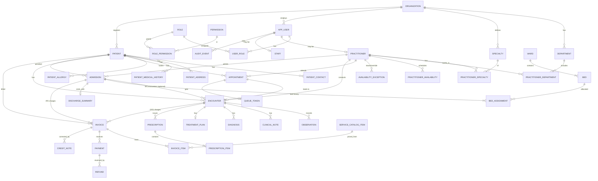
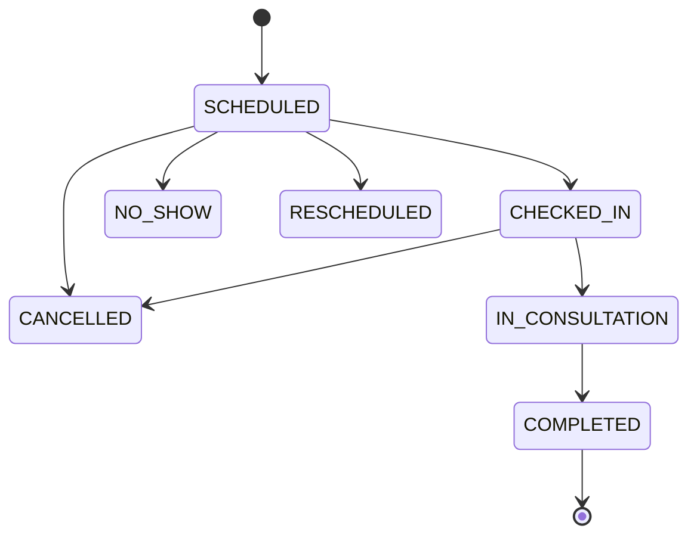
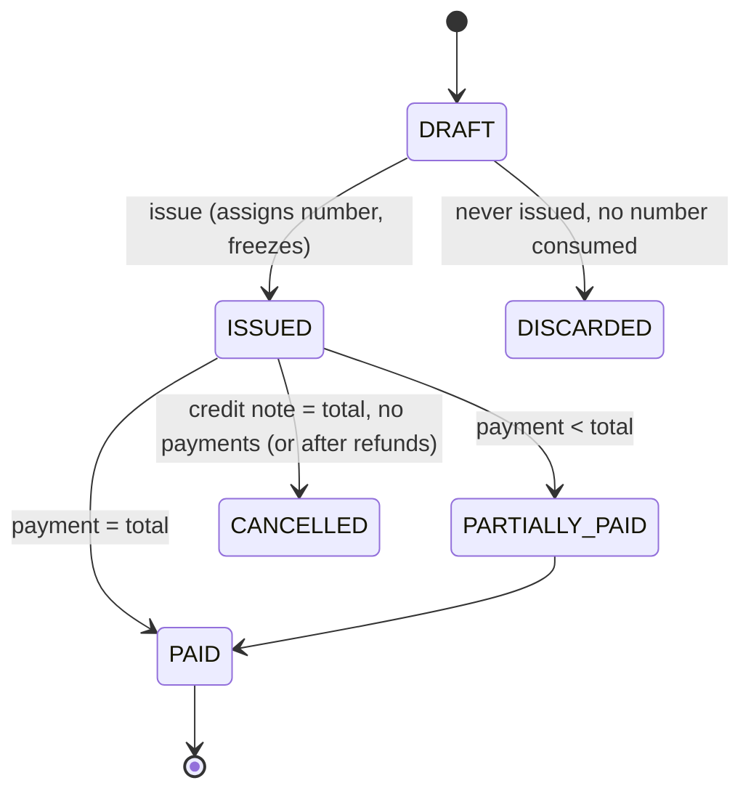

# HMS Release 1 — Domain Model (v0.2, draft)

## 1. Conventions
- Every business entity carries `organization_id` (ownership). This is **ownership, not isolation**: isolation additionally needs enforced scoping in every query (repository-level filter + tests) and, as defense in depth, PostgreSQL RLS (ADR-0010). Neither is claimed to be complete tenant isolation until the isolation test suite passes.
- IDs: UUID v7 (app-generated). Human identifiers (UHID, invoice no.) are separate unique business keys.
- Cross-module references are by ID only; no JPA associations across modules.
- "Facility" is represented by `organization` row settings (timezone etc.) in R1.

## 2. Entities by module
| Module | Entities | Aggregate roots |
|---|---|---|
| organization | Organization, Department, Specialty | Organization, Department, Specialty |
| identity | User, Role, Permission, UserRole, RolePermission, (UserSession via Spring Session) | User, Role |
| practitioner | Practitioner, Staff, PractitionerSpecialty, PractitionerDepartment, PractitionerAvailability, AvailabilityException | Practitioner, Staff |
| patient | Patient, PatientContact, PatientAddress, PatientMedicalHistory, PatientAllergy | Patient (children owned) |
| appointment | Appointment, AppointmentSchedule (slot config), QueueToken | Appointment |
| clinical | Encounter, Observation, ClinicalNote, Diagnosis, TreatmentPlan, Prescription, PrescriptionItem | Encounter (owns notes, observations, diagnoses, plan); Prescription (owns items) |
| admission | Admission, DischargeSummary | Admission |
| bedmanagement | Ward, Bed, BedAssignment | Ward (owns beds); BedAssignment (own aggregate, see §5) |
| billing | ServiceCatalogItem (+price versions), Invoice, InvoiceItem, CreditNote, InvoiceNumberSequence | Invoice (owns items), ServiceCatalogItem |
| payment | Payment, Refund | Payment, Refund |
| audit | AuditEvent | AuditEvent (append-only) |
| reporting | read models only (SQL views/queries) | — |

Notes on deviations from the master list:
- `AppointmentStatus` is an enum/state machine, not a table. `AppointmentSchedule` is modelled as practitioner slot configuration (slot length, max walk-ins) living with availability.
- Added: `Observation` (vitals as structured rows), `CreditNote`, `AvailabilityException`, `QueueToken`, `InvoiceNumberSequence`, `PractitionerDepartment`. Justified by requirements OPD-2, BIL-4, PRC-4, APT-4, BR-B2, PRC-3.
- Split: `bedmanagement` module owns Ward/Bed/BedAssignment; `admission` owns the stay. Admission calls `BedManagement` through an interface so the bed invariant has a single owner.
- Payment and Billing are two modules per the master module list; Payment depends on Billing's public API (`InvoiceQuery`, `InvoiceBalancePort`), not the reverse.

## 3. ER diagram

(All entities also reference `ORGANIZATION` via `organization_id`; omitted from the diagram for readability. Table `APP_USER` because `user` is reserved in PostgreSQL.)

## 4. Cardinalities and ownership decisions
| Relationship | Cardinality | Decision |
|---|---|---|
| Patient ↔ Encounter | 1:N | Encounter always has a patient |
| Appointment ↔ Encounter | 1:0..1 | Walk-ins also create an appointment (type WALK_IN) so the queue has one model |
| Admission ↔ Encounter | 1:N (optional) | OPD encounter may *precede* admission (source); IPD rounds are encounters of type IPD linked to admission. Admission is **not** an Encounter (master rule) |
| Admission ↔ BedAssignment | 1:N, ≤1 open | History retained |
| Bed ↔ BedAssignment | 1:N, ≤1 open | Enforced by partial unique index |
| Invoice ↔ Payment | 1:N | Payment belongs to exactly one invoice in R1 |
| Practitioner ↔ Specialty | N:M | Join table with `is_primary` |
| User ↔ Practitioner | 1:0..1 | Not every user is a practitioner; every practitioner has a user (can log in) — [A] practitioners without login deferred |
| Patient ↔ Address/Contact | 1:N | One current per type via partial unique index |

## 5. Aggregate boundaries & transactional rules
| Aggregate | Boundary | Consistency |
|---|---|---|
| Patient | Patient + contacts, addresses, history, allergies | Updated in one transaction; optimistic lock (`version`) |
| Appointment | Appointment (+ QueueToken created on check-in) | Overlap enforced by DB exclusion constraint, not just app checks |
| Encounter | Encounter + observations + notes + diagnoses + treatment plan | Finalize transitions whole aggregate to read-only; addenda are new `ClinicalNote` rows of kind ADDENDUM |
| Prescription | Prescription + items, belongs to Encounter by ID | Created within finalized or open encounter; immutable once `ISSUED` (new version row supersedes) |
| Ward / Bed | Ward owns bed definitions (config); occupancy state is **not** stored on Bed | |
| BedAssignment | Separate aggregate keyed by bed & admission | "Bed occupied" = existence of an open assignment (single source of truth, no flag to drift) |
| Admission | Admission + discharge summary | Status transitions guarded; discharge coordinates bed release + invoice via application service in one transaction |
| Invoice | Invoice + items + credit notes | Totals recomputed from items on issue; frozen after |
| Payment | Payment + refunds | Append-only; `Invoice.amount_paid` is derived by query (or maintained transactionally under invoice row lock — see ADR-0012) |

## 6. Lifecycles

Payment status on the invoice (UNPAID/PARTIAL/PAID) is derived; `CANCELLED` is via credit note. Encounter: `OPEN → FINALIZED`. Admission: `ADMITTED → DISCHARGE_INITIATED → DISCHARGED` (+ `CANCELLED` if admitted by mistake before any charge). Bed: `ACTIVE ↔ OUT_OF_SERVICE`. User: `ACTIVE ↔ INACTIVE` (+ `LOCKED`). Patient: `ACTIVE/INACTIVE/MERGED/DECEASED`.

## 7. Business invariants (enforcement layer)
| # | Invariant | Enforced by |
|---|---|---|
| I1 | ≤1 open BedAssignment per bed | Partial unique index `WHERE released_at IS NULL` + `SELECT … FOR UPDATE` on bed row |
| I2 | ≤1 open BedAssignment per admission | Partial unique index |
| I3 | ≤1 active admission per patient | Partial unique index on status in (ADMITTED, DISCHARGE_INITIATED) |
| I4 | No overlapping active appointments per practitioner | `EXCLUDE USING gist (practitioner_id WITH =, tstzrange(start_at,end_at) WITH &&) WHERE status in active set` |
| I5 | UHID unique per org | Unique `(organization_id, uhid)` |
| I6 | Invoice number unique per org/FY, gapless | Unique + counter row locked `FOR UPDATE` at issue |
| I7 | Issued invoice/items immutable | App state check + DB trigger rejecting UPDATE/DELETE on items of non-DRAFT invoices |
| I8 | Payments/audit never updated or deleted | Triggers raise on UPDATE/DELETE; app role lacks privileges where practical |
| I9 | Σ(payments) − Σ(refunds) ≤ invoice total | Invoice row locked `FOR UPDATE` during payment; CHECK on derived value in tests |
| I10 | Finalized encounter immutable | App state + trigger on child tables |
| I11 | Same-org references | Composite FK `(organization_id, id)` for cross-entity references inside the same module group (see database design §4) |
| I12 | Money ≥ 0, qty > 0 | CHECK constraints |

## 8. Domain events (in-process, transactional publication via Spring `ApplicationEventPublisher`; outbox deferred)
| Event | Producer | Consumers |
|---|---|---|
| PatientRegistered / PatientUpdated | patient | audit |
| AppointmentBooked / CheckedIn / Cancelled | appointment | audit, reporting |
| EncounterFinalized | clinical | billing (suggest consultation charge), audit |
| AdmissionCreated / BedAssigned / BedTransferred / PatientDischarged | admission, bedmanagement | billing (room charges), audit |
| InvoiceIssued / InvoiceCancelled | billing | audit |
| PaymentRecorded / RefundRecorded | payment | billing (status), audit |
Rule: events are for decoupling side-effects that must succeed or fail **with** the originating transaction (`@ApplicationModuleListener` is async/after-commit — use plain synchronous listeners for audit and invariants; use after-commit only for non-critical effects like notifications later).

## 9. Open modelling questions
| ID | Question | Default |
|---|---|---|
| M1 | Should daily room charges be materialised as invoice items nightly (job) or computed at invoice time? | **Compute at invoicing** (from BedAssignment history) + preview endpoint; avoids a scheduler for solo dev. Interim invoices cover long stays. |
| M2 | Is a prescription per encounter only, or also at discharge? | Per encounter; discharge medications go in DischargeSummary as structured lines |
| M3 | Patient photo/ID documents | Out of R1 |
