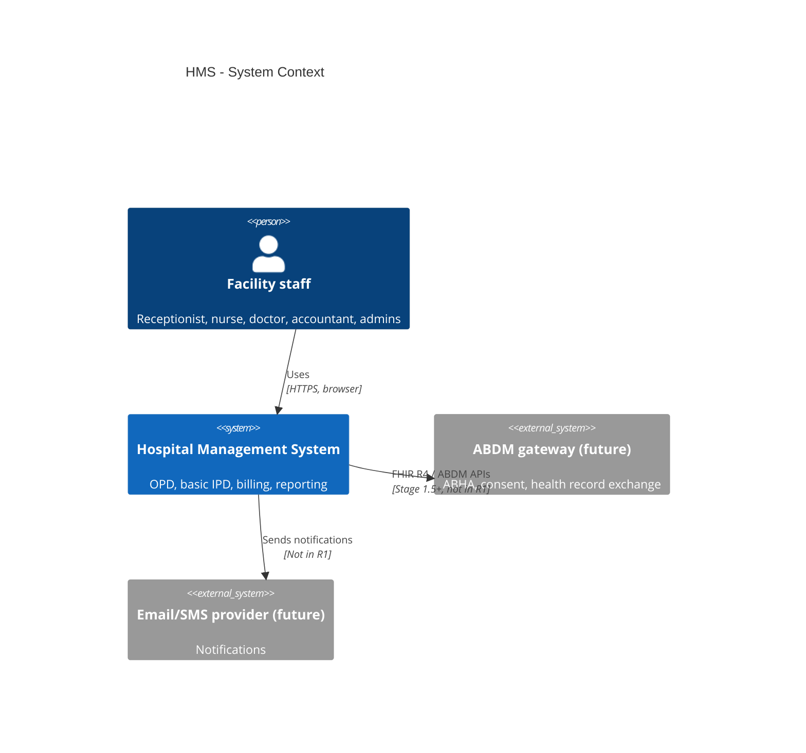
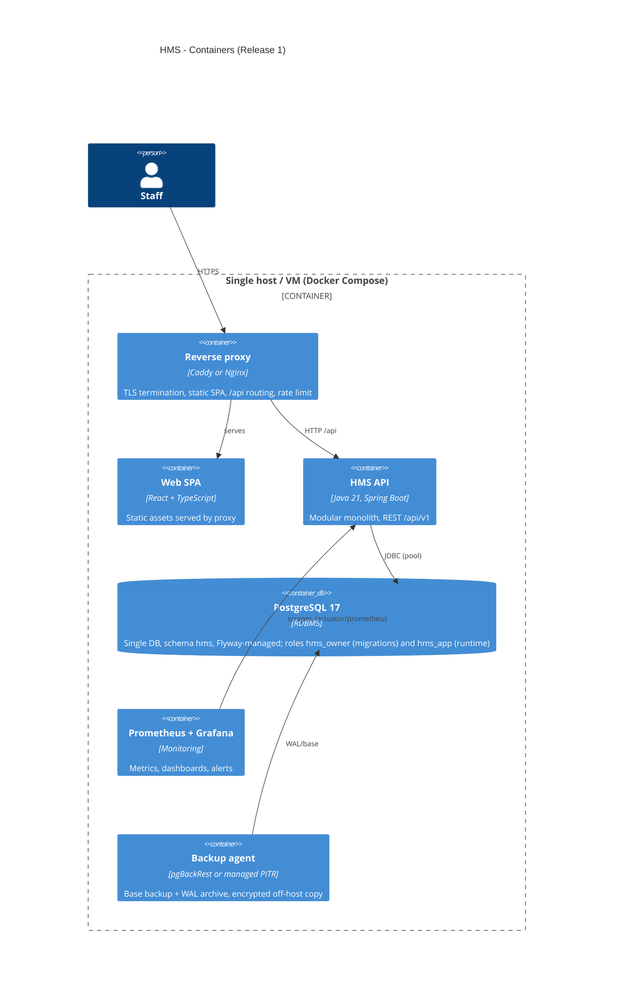
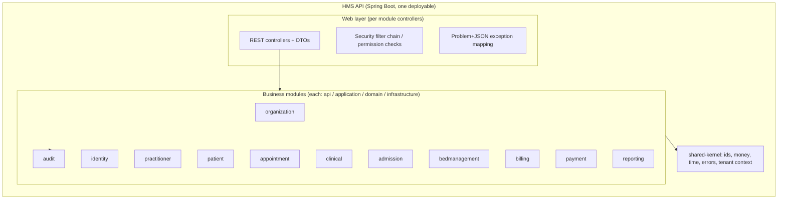
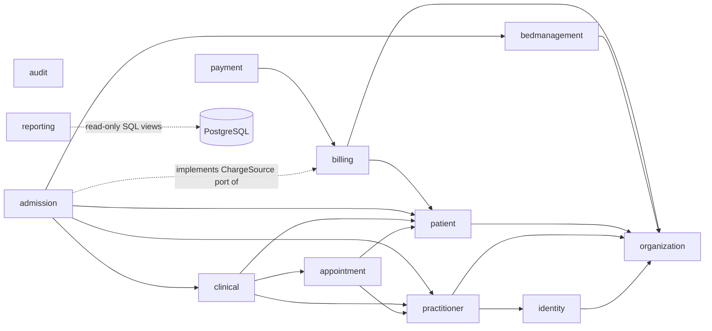
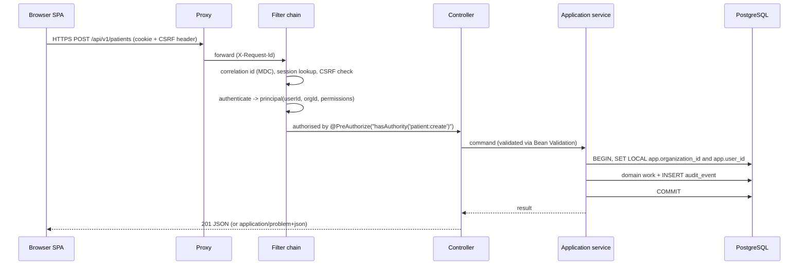
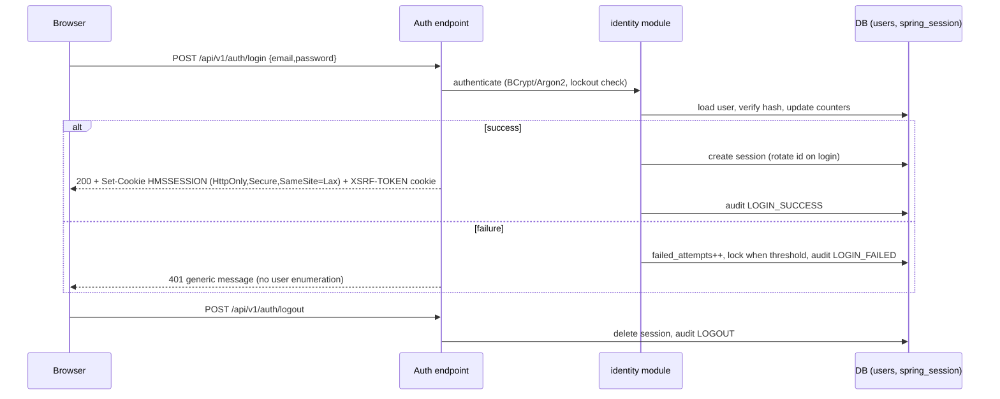
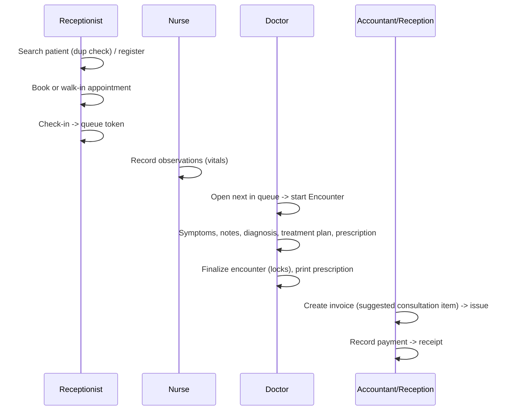
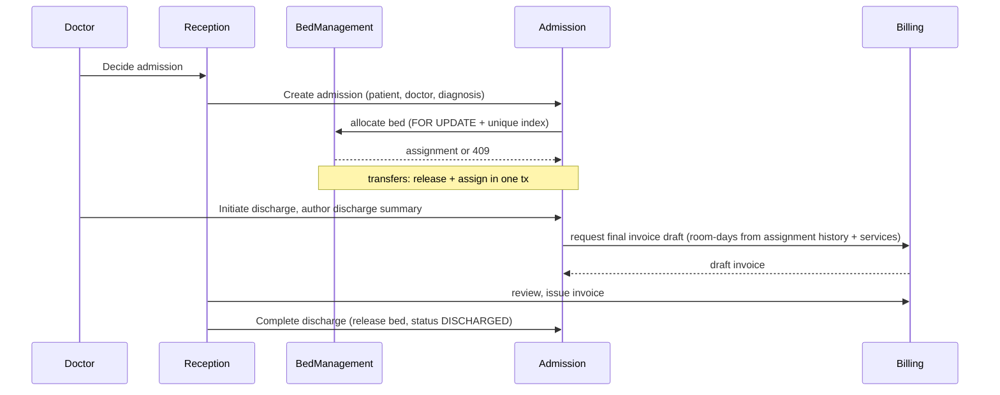
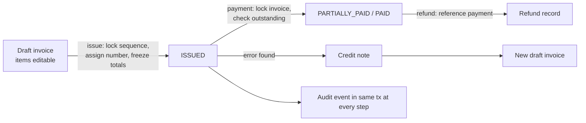
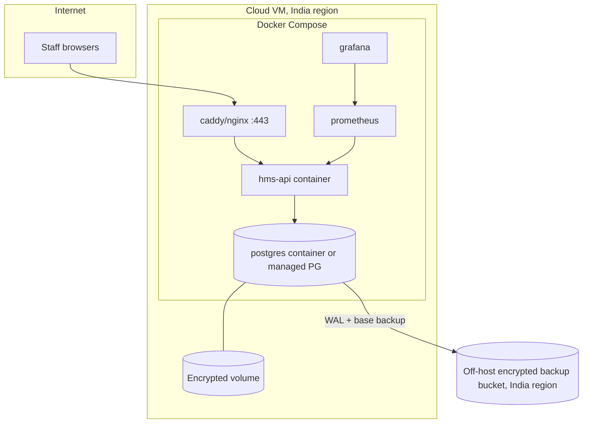

# HMS — High-Level Architecture (v0.2, draft)

## 1. C4 Level 1 — System context


## 2. C4 Level 2 — Containers

Rationale for scale: 50 concurrent users fit comfortably on one app instance + one PG. No Redis (sessions in PostgreSQL via Spring Session JDBC), no queue (in-process events), no object store in R1 (PDFs rendered on demand, not stored; attachments out of scope). Introduce each only when a requirement forces it.

## 3. C4 Level 3 — API components (modules)


## 4. Module dependency diagram (allowed direction: arrow = "may call the public API of")

All modules may publish audit events through `audit`'s public `AuditRecorder` interface (omitted arrows for readability). Billing does **not** depend on admission/clinical: it reacts to events (`PatientDischarged`, `EncounterFinalized`) and receives charge lines via its own API. Billing owns a small `ChargeSource` port; admission implements it to supply room-day charges (dependency inversion — the dotted arrow means admission depends on billing's `api` package, never the reverse). Reporting reads SQL views, not other modules' repositories; views are owned and versioned by reporting (documented exception to the "no arbitrary access" rule, ADR-0001). Boundary enforcement: ArchUnit rules in the `architectureTest` source set, run in CI (ADR-0001, accepted; Spring Modulith deferred).

## 5. Layering inside a module
```
module/
  api/             public interfaces + DTOs usable by other modules (the ONLY package others may import)
  application/     use-case services (@Transactional boundary), command/query handlers
  domain/          entities, value objects, domain services, state machines, events
  infrastructure/  JPA repositories, adapters
  web/             REST controllers, request/response DTOs (internal)
```
Transaction boundary = application service method. Controllers never open transactions. Cross-module calls inside one use case participate in the caller's transaction (monolith benefit) but go through `api` interfaces.

## 6. Request flow


## 7. Authentication flow (proposed: server-side session)

Idle timeout 30 min (configurable), absolute 12 h. Admin deactivation deletes the user's sessions immediately. See ADR-0005 for the deviation from the charter's JWT proposal.

## 8. OPD flow


## 9. IPD flow


## 10. Billing flow


## 11. Deployment diagram

Environments: local compose → staging (synthetic data only) → production. CI builds an image tagged by git SHA; staging auto-deploys; production is a manual promote. Rollback = redeploy previous image; DB migrations are forward-only and written **expand/contract** compatible so the previous app version works with the new schema for at least one release.

## 12. Cross-cutting concerns
| Concern | Approach |
|---|---|
| Errors | RFC 7807 `application/problem+json` with stable `code` |
| Observability | JSON logs with `correlationId`, `userId`, `orgId`; no PHI in logs (log filter + tests); Micrometer → Prometheus; health: liveness/readiness; per-module attribution, dashboards and alerts per ADR-0014 |
| Configuration | 12-factor env vars; secrets via env from secret store/docker secrets; never in repo |
| Time | `Clock` injected; all `Instant`; facility TZ (Asia/Kolkata constant in R1, database-design.md D2) only for day and financial-year boundaries |
| Money | `Money` value object over `BigDecimal` (scale 2) |
| API docs | springdoc-openapi; spec checked in CI for breaking changes |
| Idempotency | `Idempotency-Key` header on payment/refund/invoice-issue POSTs |
